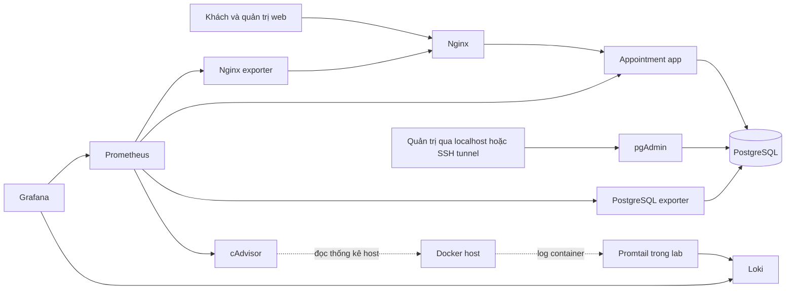

# Tổng quan đề tài hệ thống đặt lịch hẹn

Ngày phân tích: 24/10/2026.

> Cập nhật phạm vi 24/10/2026: người dùng đã bỏ VPS. Mục tiêu duy nhất là chạy ổn định toàn bộ stack Docker Compose trên localhost. Các phần VPS/domain trong nội dung phân tích lịch sử không còn là yêu cầu; xem README gốc, kế hoạch local và trạng thái thực tế.

Đề 40 yêu cầu xây dựng và triển khai website đặt lịch hẹn, dùng PostgreSQL và pgAdmin, vận hành toàn bộ bằng Docker Compose. Sản phẩm hoàn chỉnh cần đồng thời có website hoạt động, reverse proxy Nginx, metrics Prometheus và Grafana, log Loki và Promtail, các biện pháp hardening, repository GitHub và báo cáo ít nhất 10 trang có hình minh chứng.

Hướng thực hiện là một ứng dụng nghiệp vụ nhỏ, đủ dịch vụ, khung giờ, khách hàng và xác nhận lịch; dành thời gian tương xứng cho hạ tầng và nghiệm thu. Kế hoạch bao phủ từ khởi tạo mã nguồn đến triển khai trên môi trường đích, thử phục hồi dữ liệu và hoàn thiện báo cáo. Hồ sơ này không xác nhận hệ thống đã chạy.

## 1 Nguồn tài liệu và thứ tự ưu tiên

| Mã | Tài liệu trong thư mục docx | Vai trò |
| --- | --- | --- |
| S01 | Đề tài Thực hành - Triển khai và Quản trị Hệ thống Phần mềm (Đề 40).docx | Nguồn yêu cầu bắt buộc và thang điểm |
| S02 | Bao_Cao_Trien_Khai_He_Thong.docx | Khung tham khảo để viết báo cáo sau triển khai |
| S03 | chapter01.pdf, 19 trang | Tổng quan triển khai, Linux, Nginx, TLS |
| S04 | chapter02.pdf, 23 trang | Docker, Dockerfile, image, volume và network |
| S05 | chapter03.pdf, 14 trang | Điều phối bằng Compose và so sánh Kubernetes |
| S06 | chapter04.pdf, 21 trang | Git, GitHub, workflow và CI/CD |
| S07 | chapter05.pdf, 12 trang | Reverse proxy, Nginx Proxy Manager và domain |
| S08 | chapter06.pdf, 13 trang | Quản trị database, role, quyền và xác thực |
| S09 | chapter07.pdf, 18 trang | Prometheus, Grafana và exporter |
| S10 | chapter08.pdf, 15 trang | Loki, Promtail, LogQL và alerting |
| S11 | chapter09.pdf, 16 trang | Hardening Linux, firewall, SSH và chống brute force |
| S12 | Bao_cao_Appointment_System.docx | Báo cáo mẫu bổ sung; trang đầu là mẫu bìa người dùng chỉ định |

Đã trích xuất nội dung 3 file Word và toàn bộ 151 trang PDF. S12 được bổ sung trong lúc phân tích. File Word dùng mốc đoạn `P`, PDF dùng số trang của từng file; xem `sources/` để tra cứu. Không tìm thấy AGENTS.md trong workspace ở thời điểm khảo sát.

Khi có khác biệt: ưu tiên S01; dùng chapter để hiểu và triển khai; kiểm tra tài liệu chính thức của công cụ khi cú pháp hoặc vòng đời phần mềm đã thay đổi. Bài thực hành WordPress/MySQL trong chapter là ví dụ học tập, không thay thế chủ đề Appointment/PostgreSQL của đề 40.

## 2 Hiện trạng project

| Hạng mục | Kết quả khảo sát |
| --- | --- |
| Mã nguồn | Chưa có mã nguồn, manifest thư viện, Dockerfile hay Compose |
| Tài liệu | Có 12 file nguồn sau khi bổ sung S12; Assets chưa có file |
| Git | Chưa có .git local; remote đã được cung cấp và kiểm tra ls-remote thành công nhưng không có refs, có dấu hiệu repo rỗng |
| Công cụ | Tìm thấy Git, Node.js, npm và SSH trên PATH; chưa kiểm tra phiên bản/chạy thử |
| Docker | Không tìm thấy trên PATH và đường dẫn cài Docker Desktop thông dụng; chưa khẳng định toàn máy không có Docker |
| Hạ tầng | Chưa có thông tin VPS, domain, quyền truy cập hay ngân sách |
| Thông tin cá nhân | Nguyễn Văn Mạnh, MSSV dtc245200223, lớp CNTTK23B; hạn nộp trong 24 giờ kể từ thời điểm trao đổi |
| Báo cáo | S02 là khung chưa có ảnh; S12 là mẫu có 16 media, không phải minh chứng của project hiện tại |

Định danh chính thức do người dùng xác nhận: `dtc245200223`. Repository: https://github.com/vzmanhdev/dtc245200223_dat_lich_hen.git. Môi trường cuối theo yêu cầu người dùng: chỉ localhost, bỏ VPS. Tài khoản GitHub hiện là `vzmanhdev`, tên repo có MSSV; cần ghi rõ cách đáp ứng chỉ dẫn đặt tên theo MSSV của giảng viên, không tự tạo tài khoản mới.

## 3 Phân tích đề bài và điểm số

Các đoạn tham chiếu dưới đây thuộc S01 trong bản trích xuất.

| Nhóm | Điểm | Yêu cầu bắt buộc | Kết quả phải chứng minh |
| --- | --- | --- | --- |
| GitHub | 1,5 | Source và cấu hình đầy đủ, ít nhất 3 commit có ý nghĩa, README; định danh theo MSSV theo chỉ dẫn đề | URL repo, lịch sử commit, dựng lại theo README |
| Web và DB | 1,5 | Website đặt lịch; PostgreSQL và pgAdmin | Đặt lịch qua UI, dữ liệu xuất hiện trong PostgreSQL qua pgAdmin |
| Nginx | 1,5 | Reverse proxy; HTTPS tự ký hoặc security headers cơ bản | Truy cập qua Nginx, kiểm tra header/TLS và routing |
| Metrics | 1,5 | Prometheus và Grafana theo dõi container, web, DB | Targets thu thập được, dashboard có dữ liệu thật ở cả 3 lớp |
| Log | 1,5 | Loki và Promtail; ít nhất 2–3 query LogQL | Thu thập log thật và chạy 3 query có kết quả/diễn giải |
| Hardening | 1,5 | Ít nhất 3–4 biện pháp | Cấu hình và kiểm tra thực tế non-root, mạng, mật khẩu, quyền DB, header… |
| Tổng thể và trình bày | 1,0 | Compose chạy đầy đủ, demo rõ ràng, screenshot và hiểu kiến thức | Kịch bản demo và minh chứng khớp hệ thống |
| Tổng | 10,0 | Báo cáo tối thiểu 10 trang, có bìa và hình minh họa | Báo cáo mô tả đúng kết quả đã thực hiện |

Nguồn: S01 P4–14, P19–38, P43–47. Stack Node.js hoặc Django chỉ là gợi ý; PostgreSQL và pgAdmin là lựa chọn được chỉ định của đề 40. Đề không buộc Kubernetes, microservices nghiệp vụ, thanh toán, email/SMS hay CI/CD tự động. Không suy ra phải làm mọi bài lab ở cuối 9 chapter.

Mục tiêu nội bộ chọn 3 query LogQL và ít nhất 5 biện pháp hardening để có khoảng dự phòng khi nghiệm thu. HTTPS công khai với chứng chỉ được tin cậy là mục tiêu deploy Internet; yêu cầu chấm điểm tối thiểu vẫn cho phép security headers hoặc HTTPS tự ký.

## 4 Bài toán cần giải quyết

Khách hàng cần biết có dịch vụ gì và thời điểm nào còn trống để đặt hẹn. Người quản trị cần tạo dịch vụ, mở/đóng khung giờ, xem thông tin người đặt và xác nhận hoặc hủy lịch. Hệ thống phải ngăn hai khách cùng giữ một khung giờ khi thao tác đồng thời và lưu dữ liệu bền vững khi container khởi động lại.

Ở góc độ học phần, bài toán tiếp theo là đóng gói và vận hành hệ thống có thể dựng lại: truy cập qua một cổng Nginx; tách database khỏi Internet; quan sát được tài nguyên, request và DB; tìm được log khi lỗi; có quy trình backup, cập nhật và quay lại bản ổn định.

### Phạm vi MVP đề xuất

- Một đơn vị cung cấp dịch vụ, một nguồn lực phục vụ tại mỗi thời điểm.
- Khách xem dịch vụ, chọn khung giờ, nhập họ tên và thông tin liên hệ, nhận mã lịch và trạng thái chờ xác nhận.
- Quản trị viên đăng nhập; quản lý dịch vụ, khung giờ; xác nhận/hủy/đánh dấu hoàn thành; lọc lịch theo ngày và trạng thái.
- Khách tra cứu/hủy lịch bằng mã và token riêng; không cho tìm lịch chỉ bằng số điện thoại hoặc ID tăng dần.
- Xác nhận hiển thị trong ứng dụng, không phụ thuộc email/SMS để demo.

Đây là thiết kế nghiệp vụ đề xuất để cụ thể hóa mô tả ngắn trong S01 P44, không phải các điều khoản nguyên văn của giảng viên. Nếu cần nhiều nhân viên/phòng hoặc thời lượng linh hoạt, phải mở rộng mô hình tài nguyên và ràng buộc chống chồng lấn trước khi lập trình.

### Ngoài phạm vi bản đầu

Thanh toán, lịch lặp, đồng bộ Google Calendar, nhiều chi nhánh, mobile app, AI, Kubernetes, HA nhiều máy và hệ thống nhắn tin thật. CI tự kiểm tra/build là cải tiến hữu ích; tự động CD và Alertmanager là phần mở rộng sau khi đủ yêu cầu chấm điểm.

## 5 Kiến trúc dự kiến

Đề xuất Node.js 24 LTS, Express, giao diện render phía server bằng EJS và CSS; PostgreSQL truy cập bằng thư viện pg với SQL tham số hóa và migration có phiên bản. Một ứng dụng nghiệp vụ dạng monolith giúp giảm số phần cần phát triển. Nhiều container hạ tầng không có nghĩa ứng dụng đã được thiết kế theo microservices.

| Thành phần | Nhiệm vụ | Lưu trữ/truy cập dự kiến |
| --- | --- | --- |
| app | UI, xác thực admin, nghiệp vụ, health và metrics | Không publish port app ra host; app-net, db-net, monitoring |
| postgres | Dữ liệu nghiệp vụ | Volume riêng; chỉ db-net, không publish 5432 |
| pgadmin | Công cụ DB bắt buộc | Volume riêng; db-net; bind localhost và SSH tunnel trên VPS |
| nginx | Điểm vào web, proxy, header, TLS | Public 80/443; app-net; endpoint status nội bộ cho exporter |
| prometheus | Scrape metrics | Volume, retention hữu hạn; monitoring |
| grafana | Dashboard và Explore log | Volume và provisioning; bind localhost, không bật anonymous |
| cadvisor | CPU, RAM, I/O container | monitoring, mount host tối thiểu cần thiết; kiểm tra tương thích host |
| nginx-exporter | Chuyển stub_status thành metrics | app-net và monitoring; không public port |
| postgres-exporter | Metrics PostgreSQL | db-net và monitoring; role giám sát riêng |
| loki | Lưu và truy vấn log | Volume, retention; monitoring, không public API |
| promtail | Agent log theo đề | monitoring; cấu hình và positions bền vững; quyền đọc log cần kiểm chứng |

Node Exporter có thể bổ sung khi cần dashboard host Linux; không coi metrics VM Docker Desktop là toàn bộ metrics của máy Windows. Prometheus và Grafana không nối trực tiếp db-net. Network db-net dự kiến `internal: true`; app kết nối đồng thời các network cần thiết. Mạng Docker là phân tách theo nhóm, không thay thế authorization của từng dịch vụ.

Quyết định phiên bản image cụ thể sẽ chốt khi build thử, lưu tag/digest và ngày kiểm thử. Không dùng `latest` làm bản phát hành đã nghiệm thu. [Lịch phát hành Node.js](https://nodejs.org/en/about/previous-releases) xác nhận dòng 24 là LTS; cần chọn bản vá được hỗ trợ ở thời điểm triển khai.

## 6 Áp dụng từng chapter

| Nguồn | Nội dung đã rà soát | Áp dụng trực tiếp | Phần tham khảo/mở rộng |
| --- | --- | --- | --- |
| S03 Ch1 | DevOps và IaC tr1–5; Linux tr5–10; Nginx/TLS tr10–18; câu hỏi tr18–19 | Cấu hình lưu Git, reverse proxy, forwarded headers, kiểm tra nginx, HTTPS lab | FTP, backend Python giả lập, cân bằng tải nhiều instance |
| S04 Ch2 | Docker/VM/microservices tr1–9; Dockerfile tr9–11; CLI tr12–14; volume tr14–18; network tr18–20; web lab tr20–23 | Image, non-root, cache build, volume PostgreSQL, mạng riêng, docker logs | PHP/MySQL minh họa; không chuyển ứng dụng thành PHP theo ví dụ |
| S05 Ch3 | Compose tr1–7; K8s tr7–9; WordPress Compose tr9–14 | Compose khai báo đủ dịch vụ, biến môi trường, healthcheck và dependency | WordPress, Redis, Kubernetes không cần cho đề 40 |
| S06 Ch4 | SCM tr1–5; Git tr5–8 và tr14–21; CI/CD và Actions tr8–14 | Repo theo định danh SV, commit theo mốc, README, config như code | Pipeline build/test nên thêm; CD tự động không bắt buộc |
| S07 Ch5 | Proxy tr1–6; NPM tr6–12; domain và TLS | Nginx làm gateway, domain, TLS, giới hạn trang quản trị | NPM là lựa chọn GUI; đề xuất Nginx config trực tiếp để review Git |
| S08 Ch6 | Tài khoản, RBAC, PoLP tr1–6; Compose và pgAdmin tr6–8; MySQL tr8–10; PostgreSQL tr10–13 | Role riêng app/migration/monitoring, pgAdmin, SCRAM, audit quyền | RLS, pgcrypto, pgAudit khi có nhu cầu; MySQL không áp dụng |
| S09 Ch7 | Chỉ số tr1–4; pull/push tr4–5; Prometheus tr5–8; Grafana tr8–10; lab exporter tr10–18 | cAdvisor, PostgreSQL exporter, Nginx exporter, metrics app; provisioning dashboard | Pushgateway, cluster discovery, dashboard MySQL không dùng trực tiếp |
| S10 Ch8 | Log và parsing tr1–5; Loki/Promtail tr6–10; LogQL tr10–11; Alertmanager tr11–15 | Agent → Loki → Grafana, labels nhất quán, 3 query chạy thật | Alertmanager và kênh gửi cảnh báo sau MVP |
| S11 Ch9 | Rủi ro và phòng thủ tr1–5; firewall tr5–8; SSH tr9–11; Fail2Ban/CrowdSec tr11–16 | Non-root, mạng, quyền, firewall và SSH của VPS, scan dependency/image | CrowdSec, MFA nâng cao, lab brute force không bắt buộc |

## 7 Điểm cần hiệu chỉnh trước khi áp dụng nguồn

1. **S02 là mẫu chưa hoàn thiện.** Bìa còn placeholder, chủ đề trống, nội dung generic nhắc MySQL/phpMyAdmin, chưa có hình (OOXML không có media), chưa có cấu hình đầy đủ hoặc đầu ra kiểm tra. Không sử dụng các câu “đã kiểm chứng thành công” làm kết quả nghiệm thu. Chưa render nên không kết luận số trang hiện có.
2. **Khẳng định bảo mật quá mức.** Non-root giúp giảm rủi ro, không “ngăn chặn tuyệt đối” leo thang như S02 P42. Container có mount host/socket cần đánh giá và ghi ngoại lệ riêng.
3. **LogQL trong nguồn có lỗi.** S02 P36 sai dấu nháy/toán tử; bảng S10 tr10–11 tự ghi chú nội dung bị cắt. Cần viết lại query khớp labels và log thực tế, không copy nguyên.
4. **Promtail đã EOL.** S10 tr10 đã nhắc xu hướng này. [Grafana xác nhận EOL ngày 02/03/2026](https://grafana.com/docs/loki/latest/send-data/promtail/). Giữ profile lab Promtail để bám S01; nếu public lâu dài, dùng Alloy và lưu minh chứng Promtail riêng. Nếu muốn bỏ Promtail khỏi bài nộp, cần giảng viên xác nhận phương án tương đương; không mặc định thay yêu cầu.
5. **Không sao chép image/config cũ.** Loki schema và image phải là bộ tương thích được kiểm thử; không trộn ví dụ schema cũ với image `latest`. Không tái sử dụng mật khẩu ví dụ trong chapter.
6. **Startup khác readiness.** `depends_on` dạng ngắn chưa bảo đảm DB sẵn sàng. Dùng healthcheck, `service_healthy`, migration one-shot và retry kết nối theo [tài liệu Compose](https://docs.docker.com/compose/how-tos/startup-order/).
7. **Metrics cần đúng nguồn.** stub_status chỉ có trạng thái kết nối và số request cơ bản; không tự có latency hay phân bố mã HTTP. Lấy latency/status từ instrumentation app hoặc log; tham chiếu [Nginx stub_status](https://nginx.org/en/docs/http/ngx_http_stub_status_module.html).
8. **Cú pháp PostgreSQL phải kiểm tra.** `ALTER USER ... PASSWORD EXPIRE` trong S08 tr12 không phải cú pháp PostgreSQL chuẩn. `VALID UNTIL` điều khiển hạn dùng mật khẩu, không tự cung cấp luồng bắt đổi mật khẩu lần đầu. Tham chiếu [ALTER ROLE](https://www.postgresql.org/docs/current/sql-alterrole.html).
9. **Firewall phải tính đến Docker.** Không chỉ chụp `ufw status` để kết luận port container kín. Docker published ports có thể đi vòng quy tắc UFW; kiểm tra từ máy ngoài theo [tài liệu Docker](https://docs.docker.com/engine/network/packet-filtering-firewalls/).
10. **Bảo mật bí mật và dữ liệu log.** Không đưa secret vào build ARG, image hoặc Git; không bật ghi mọi câu SQL trên môi trường chứa dữ liệu thật chỉ để có log demo. Không đưa số điện thoại/email/token vào labels hoặc log.
11. **Ví dụ WordPress không đổi DB bằng cách chỉ đổi image.** S05 tr14 có bài gợi ý thay MySQL bằng PostgreSQL; tính tương thích ứng dụng/driver/schema phải được xét lại. Project này xây app hỗ trợ PostgreSQL ngay từ đầu.

## 8 Điều kiện đầu vào còn thiếu

Đã xác nhận deadline 24 giờ, họ tên/MSSV/lớp, repo và trình tự máy cá nhân → VPS. Mốc ghi nhận để lập lịch là 00:37 ngày 24/10/2026 (UTC+7); hạn kế hoạch xấp xỉ 00:37 ngày 25/10/2026. Cần ưu tiên kế hoạch nước rút 24 giờ trong file 03 thay cho ước lượng phát triển thông thường.

Còn thiếu quyền SSH/IP/cấu hình VPS, domain/quyền DNS nếu có và ngân sách; cần chốt ngay trong giờ đầu. Không có các đầu vào này sẽ chặn triển khai VPS dù local hoàn tất. Không coi localhost là URL triển khai Internet.

### Báo cáo mẫu Appointment và bìa được chỉ định

S12 P1–17 chứa tên trường, khoa, môn học, đề tài Appointment, thông tin người thực hiện, giảng viên và địa danh/ngày tháng. Người dùng yêu cầu lấy bố cục bìa đầu của file này; khi tạo báo cáo cuối phải giữ bố cục/khung/logo/font của bản gốc và thay thông tin bằng Nguyễn Văn Mạnh, dtc245200223, CNTTK23B. Giữ tên giảng viên Nguyễn Anh Chuyên theo mẫu trừ khi có điều chỉnh; ghi rõ đây là thông tin lấy từ mẫu. Ngày trên bìa là ngày hoàn thiện/nộp thực tế. Lượt này chỉ chỉ định mẫu bìa, chưa tạo hoặc sửa báo cáo Word.

S12 mô tả hệ thống Node.js/Express, PostgreSQL 17, 10 service Compose, dashboard, log và 16 media. Có thể tham khảo cách trình bày chương, danh mục ảnh/bảng và lỗi vận hành; không dùng lại kết quả, ảnh, số lịch, đường dẫn máy hay thông tin sinh viên của mẫu như kết quả cá nhân.

Các điểm cần kiểm chứng khi học theo S12: P288 chỉ mô tả kiểm tra giao thoa rồi ghi transaction, chưa đủ chứng minh chống tranh chấp đồng thời ở DB; P292 mô tả chỉ sửa lịch pending, khác luồng confirmed → completed của thiết kế mới; P474–490 ghi tra cứu/đổi lịch/login đạt nhưng P563/P570 còn nói cần kiểm thử riêng xác thực và chức năng. P414/P565 cũng nêu hạn chế định danh metrics cAdvisor. Do đó không coi bảng “Đạt” trong mẫu là kết quả kiểm thử project này. Smart quotes trong query ở P419–425 phải đổi thành dấu nháy ASCII nếu dùng làm cấu hình/query.

## 9 Định nghĩa kết quả cuối

Hoàn thành khi người khác dựng lại được hệ thống từ repository theo README; đặt lịch và xác nhận qua Nginx thành công; dữ liệu còn sau restart; pgAdmin truy cập được theo kênh quản trị; dashboard có dữ liệu container/web/DB; Loki trả kết quả 3 query; hardening được kiểm tra; backup đã restore thử; môi trường đích được nghiệm thu; báo cáo đủ ít nhất 10 trang với ảnh thật và lịch sử ít nhất 3 commit có ý nghĩa.

Danh sách chi tiết và trình tự thực hiện nằm trong [kế hoạch project](03_KE_HOACH_PROJECT.md) và [kế hoạch deploy](04_DEPLOY_VA_NGHIEM_THU.md).
