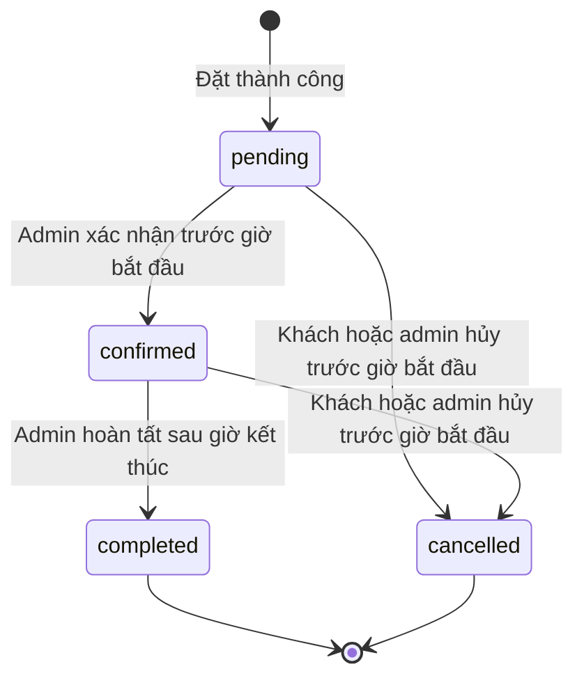

# Phân tích yêu cầu hệ thống đặt lịch hẹn

Ngày lập: 24/10/2026. Cập nhật: localhost đã nghiệm thu; mở rộng tài khoản khách và nhiều chuyên viên đã qua integration. Đặc tả triển khai hiện tại xem [nghiệp vụ v2](06_NGHIEP_VU_TAI_KHOAN_VA_CHUYEN_VIEN.md); các phần CRUD trong thiết kế bên dưới vẫn chưa triển khai đầy đủ.

> Cập nhật phạm vi 24/10/2026: người dùng đã bỏ VPS. Mục tiêu duy nhất là chạy ổn định toàn bộ stack Docker Compose trên localhost. Các phần VPS/domain trong nội dung phân tích lịch sử không còn là yêu cầu; xem README gốc, kế hoạch local và trạng thái thực tế.

Đã nhận hạn nộp 24 giờ. Phạm vi P0/P1 trong file 03 quyết định tính năng thực hiện trước hạn; đặc tả này giữ cả đích mở rộng. Tra cứu token, idempotency nâng cao và CRUD quản trị đầy đủ được xếp P1 nếu chưa đủ thời gian; chức năng đặt lịch, chống trùng DB và xác nhận có phân quyền luôn là P0.

S01 là file đề 40; S02 là báo cáo mẫu; S03–S11 là chapter01–09 theo [danh mục](01_TONG_QUAN_DU_AN.md). Đánh dấu `Bắt buộc` cho yêu cầu có trong đề, `Thiết kế MVP` cho cách cụ thể hóa nghiệp vụ và `Vận hành` cho tiêu chí bổ sung để triển khai có thể kiểm chứng.

## 1 Tác nhân và phân quyền

| Tác nhân | Quyền | Giới hạn |
| --- | --- | --- |
| Khách | Xem dịch vụ, giờ trống, gửi yêu cầu đặt lịch, tra cứu/hủy lịch của mình | Không xem danh sách khách/lịch khác; không tự xác nhận |
| Quản trị ứng dụng | Đăng nhập; quản lý dịch vụ, giờ; xem danh sách khách và lịch; đổi trạng thái | Phải kiểm tra session và quyền ở server; không có quyền quản trị DB từ UI nghiệp vụ |
| Quản trị hệ thống | Deploy, backup, pgAdmin, Grafana, cấu hình hạ tầng | Dùng tài khoản và kênh truy cập quản trị riêng |
| Role DB ứng dụng | CRUD cần thiết trên bảng nghiệp vụ và session | Không superuser, không tạo role/database, không sở hữu bảng để tránh tự DROP |
| Role DB migration | Tạo/sửa schema theo migration | Chỉ dùng khi triển khai migration; không dùng cho request web |
| Role DB monitoring | Đọc thống kê PostgreSQL cần cho exporter | Không đọc dữ liệu khách hàng nếu không cần |

Theo yêu cầu mở rộng của người dùng, khách cần đăng ký/đăng nhập trước khi đặt mới. Khách xem/hủy lịch của mình trong tài khoản; token chỉ còn phục vụ tương thích lịch cũ. Mã đặt lịch là mã tham chiếu; token ngẫu nhiên riêng mới là bí mật tra cứu. Lưu hash token; không đưa token vào query string/access log. Tra cứu bằng POST hoặc cơ chế không ghi token vào log; trả thông báo chung khi tra cứu sai để hạn chế dò dữ liệu.

## 2 Luồng nghiệp vụ chính

1. Hệ thống seed dịch vụ/chuyên viên/khung giờ tương lai; khách đăng ký hoặc đăng nhập. CRUD quản trị đầy đủ còn là thiết kế chưa thực hiện.
2. Khách chọn dịch vụ, chuyên viên và ngày; server trả các slot mở, phù hợp dịch vụ và chưa có lịch đang giữ.
3. Khách chọn slot, nhập tên và ít nhất một thông tin liên hệ hợp lệ; gửi form một lần bằng khóa idempotency.
4. Server xác thực input, khóa/kiểm tra slot trong transaction; tạo customer và appointment `pending`; commit thành công mới trả mã/token.
5. Admin xác nhận `pending → confirmed`; khách có thể xem trạng thái bằng token riêng.
6. Nếu khách/admin hủy hợp lệ, lịch thành `cancelled` và slot được giải phóng trong cùng transaction.
7. Sau giờ hẹn, admin có thể chuyển `confirmed → completed`.

### Trạng thái lịch

MVP không có giữ chỗ tạm có thời hạn: lịch `pending` giữ slot cho đến khi được xác nhận hoặc hủy. Slot quá giờ không được đặt mới; lịch pending quá giờ vẫn được giữ để admin xử lý và hiển thị nhãn quá hạn. Nếu thêm tự hết hạn phải bổ sung trạng thái và job, không âm thầm làm thay đổi quy tắc trên.

## 3 Yêu cầu chức năng và ca nghiệm thu

| ID | Nguồn và mức | Yêu cầu | Nghiệm thu |
| --- | --- | --- | --- |
| FR01 | S01 P44, Bắt buộc; chi tiết MVP | Danh mục dịch vụ: tên, mô tả, thời lượng, trạng thái hoạt động | Khách chỉ thấy dịch vụ active; admin tạo/sửa được; lỗi input có thông báo |
| FR02 | S01 P44, Bắt buộc; chi tiết MVP | Khung giờ theo dịch vụ, nguồn lực và thời điểm | Chỉ trả slot mở trong tương lai; slot đã giữ không còn đặt được |
| FR03 | S01 P44, Bắt buộc; chi tiết MVP | Lưu khách hàng và lịch hẹn | Form hợp lệ tạo đúng bản ghi DB; form sai không tạo bản ghi dở dang |
| FR04 | S01 P44, Bắt buộc; chi tiết MVP | Xác nhận lịch | Admin xác nhận; trạng thái sau reload và tra cứu nhất quán |
| FR05 | Thiết kế MVP | Đăng nhập/đăng xuất admin, session bền vững | Người chưa đăng nhập không truy cập/thay đổi dữ liệu admin; session mất hiệu lực khi logout |
| FR06 | Thiết kế MVP | Quản lý dịch vụ và slot | Không tạo slot chồng thời gian cho cùng nguồn lực; không xóa slot đang có lịch |
| FR07 | Thiết kế MVP | Danh sách lịch và khách liên quan, lọc ngày/trạng thái | Admin lọc đúng, phân trang có giới hạn, không public dữ liệu liên hệ |
| FR08 | Thiết kế MVP | Tra cứu/hủy lịch riêng tư | Token đúng xem đúng lịch; token sai không lộ dữ liệu; hủy trước giờ bắt đầu giải phóng slot |
| FR09 | Thiết kế MVP | Chống đặt trùng, idempotency | 2 request đồng thời cùng slot: chỉ 1 lịch active; gửi lại cùng khóa không tạo bản sao |
| FR10 | Thiết kế MVP | Ghi nhận thay đổi trạng thái | Có thời điểm, trạng thái trước/sau và tác nhân; chuyển sai trạng thái bị từ chối |

Không yêu cầu xóa khách hàng trong demo. Dịch vụ đã có lịch chỉ được vô hiệu hóa; lịch lưu tên/thời lượng dịch vụ tại thời điểm đặt để việc sửa danh mục không thay đổi lịch sử. Thay đổi thời lượng dịch vụ chỉ tác động slot chưa có lịch hoặc slot tạo mới theo chính sách rõ ràng.

## 4 Quy tắc nghiệp vụ bắt buộc của thiết kế

- Một slot có tối đa một lịch `pending` hoặc `confirmed`; lịch `completed` giữ lịch sử sử dụng slot. Slot hoàn thành đã ở quá khứ nên không thể đặt lại.
- Kiểm tra ở tầng DB, không chỉ vô hiệu hóa nút giao diện. Dùng unique index trên `slot_id` cho trạng thái `pending`, `confirmed`, `completed`; lịch cancelled không nằm trong index.
- Chống slot chồng lấn trên cùng `resource_id` bằng exclusion constraint trên khoảng thời gian `[start_at, end_at)` cho slot mở hoặc transaction khóa tài nguyên khi tạo slot. Ưu tiên constraint PostgreSQL; migration cần tạo extension `btree_gist` bằng role phù hợp.
- Nhiều chuyên viên, mỗi người có dung lượng 1; slot thuộc một dịch vụ và một chuyên viên. Hai dịch vụ không được chồng giờ trên cùng chuyên viên; hai chuyên viên khác nhau có thể nhận lịch cùng giờ.
- `start_at < end_at`; thời lượng slot khớp snapshot thời lượng dịch vụ khi mở slot. Lịch mới phải bắt đầu trong tương lai và slot chưa bị khóa.
- Thời gian lưu bằng `timestamptz`; hiển thị theo `Asia/Ho_Chi_Minh` (UTC+7), cùng offset môi trường người dùng hiện tại. Không lưu giờ dạng chuỗi không timezone. Kiểm thử ranh giới ngày lúc gần nửa đêm.
- Chỉ admin được xác nhận/hoàn tất. Tất cả trạng thái phải qua service nghiệp vụ thống nhất và transaction.
- Khách không được sửa ngày/giờ trực tiếp; hủy rồi đặt mới. Không xóa lịch để biểu diễn hủy.
- Rate limit form đặt/tra cứu/login; validate độ dài, định dạng liên hệ và giới hạn khoảng ngày truy vấn. Render escape HTML và dùng SQL tham số hóa.
- Không gộp khách chỉ bằng tên. MVP tạo bản ghi khách cho mỗi lần đặt để tránh gán nhầm danh tính theo số điện thoại chưa xác minh; dedup có xác minh để sau.

## 5 Mô hình dữ liệu dự kiến

| Bảng | Thuộc tính chính | Ràng buộc và mục đích |
| --- | --- | --- |
| admin_users | id, username, password_hash, active, created_at | username unique; hash mật khẩu bằng thuật toán thư viện phù hợp, không lưu plaintext |
| resources | id, name, active | Seed một nguồn lực; chừa khả năng mở rộng |
| services | id, name, description, duration_minutes, active, timestamps | Thời lượng dương, tên không rỗng |
| time_slots | id, resource_id, service_id, start_at, end_at, is_open | FK; end > start; chống chồng lấn; index ngày/nguồn lực |
| customers | id, full_name, phone, email, created_at | Ít nhất phone hoặc email; không public; dữ liệu demo giả lập |
| appointments | id, booking_code, token_hash, idempotency_key, customer_id, slot_id, status, service_name_snapshot, duration_snapshot, created_at, updated_at | Code/token/key unique; FK; status check; unique slot có điều kiện |
| appointment_events | id, appointment_id, from_status, to_status, actor_type, actor_admin_id, created_at | Audit nghiệp vụ không chứa token; thay đổi cùng transaction |
| sessions | sid, session_data, expire_at | Session admin lưu server-side; hết hạn và dọn định kỳ |
| schema_migrations | version, applied_at | Migration có thứ tự và lịch sử |

Quan hệ: resource 1–N slot; service 1–N slot; customer 1–N appointment về mô hình; slot 1–N appointment lịch sử với giới hạn active; appointment 1–N event. Không dùng soft-delete mơ hồ để thay thế ràng buộc trạng thái.

Migration và seed tách riêng; seed idempotent, chỉ dữ liệu demo. Tạo admin từ secret/bootstrap riêng; không để tài khoản/mật khẩu cố định trong seed public. Cần quyền sequence/schema đúng cho app; revoke quyền CREATE không cần thiết. Tránh app là owner của bảng vì owner có thể DROP dù không có GRANT DROP.

### Bộ dữ liệu demo dự kiến

- 3 dịch vụ, một nguồn lực, slot tạo tương đối theo ngày chạy demo để không bị toàn giờ quá khứ.
- Tối thiểu 12 slot phân bố 3 ngày, không chồng nhau; có slot mở và đóng.
- Khách giả lập và lịch thuộc đủ 4 trạng thái; không dùng dữ liệu cá nhân thật.
- Một slot trống riêng để thử 2 request đồng thời; một lịch có thể hủy để chứng minh giải phóng slot.

## 6 Giao diện và HTTP dự kiến

Giao diện tiếng Việt, responsive: danh mục dịch vụ; lịch chọn ngày/giờ; form đặt; kết quả đặt và tra cứu; đăng nhập admin; dashboard danh sách lịch; quản lý dịch vụ và slot. Có loading/empty/error state, thông báo slot vừa được người khác đặt và xác nhận trước thao tác hủy.

| Endpoint dự kiến | Quyền | Mục đích |
| --- | --- | --- |
| GET / | Public | Trang đặt lịch |
| GET /api/services | Public | Dịch vụ đang hoạt động |
| GET /api/slots?serviceId=&date= | Public | Slot còn trống theo ngày hợp lệ |
| POST /api/appointments | Public có rate limit và CSRF theo cơ chế form | Tạo lịch, trả code/token một lần; 409 khi trùng |
| POST /api/appointments/lookup | Token riêng trong body | Tra cứu lịch; không log body/token |
| POST /api/appointments/cancel | Token riêng trong body | Hủy hợp lệ, CSRF/Origin theo cách triển khai |
| GET và POST /admin/login | Public có rate limit | Form và xử lý đăng nhập |
| POST /admin/logout | Admin và CSRF | Kết thúc session |
| GET /admin/appointments | Admin | Danh sách/lọc |
| POST /admin/appointments/:id/status | Admin và CSRF | Đổi trạng thái qua service nghiệp vụ |
| GET và POST /admin/services | Admin; POST có CSRF | Danh mục dịch vụ |
| GET và POST /admin/slots | Admin; POST có CSRF | Quản lý slot |
| GET /health/live | Nội bộ hoặc healthcheck | Tiến trình phản hồi |
| GET /health/ready | Nội bộ | Kiểm tra kết nối DB/schema; 503 nếu chưa sẵn sàng |
| GET /metrics | Chỉ monitoring | Metrics; Nginx public phải chặn route này |

Endpoint là hợp đồng dự kiến, được điều chỉnh nhất quán trong triển khai và kiểm thử. Lỗi validation dùng 400/422; xác thực 401 hoặc redirect login cho HTML; thiếu quyền 403; không có dữ liệu 404; xung đột 409; lỗi nội bộ 500 không lộ stack trace/secret.

## 7 Yêu cầu triển khai và truy vết đề bài

| ID | Nguồn | Yêu cầu | Đầu ra và kiểm tra |
| --- | --- | --- | --- |
| INF01 | S01 P4, P20 | GitHub source/config/README, ≥3 commit có ý nghĩa | URL repo, commit SHA theo 3 mốc; clone mới dựng được |
| INF02 | S01 P5, P14, P45 | Toàn bộ service chạy Compose, PostgreSQL và pgAdmin | Compose hợp lệ; app kết nối DB; Query Tool xem lịch |
| INF03 | S01 P6, P26 | Nginx reverse proxy, HTTPS hoặc headers | curl/browser qua Nginx; app không có cổng host trực tiếp |
| OBS01 | S01 P7, P29 | Prometheus thu thập và Grafana hiển thị container/web/DB | Targets UP; panel có mẫu thật; cấu hình datasource/dashboard lưu Git |
| OBS02 | S01 P8, P32 | Loki và Promtail, 2–3 LogQL | 3 query đã chạy với labels thật, ảnh và log mẫu |
| SEC01 | S01 P9, P35 | Ít nhất 3–4 hardening | UID non-root app, db-net, secrets, least privilege DB, header; bằng chứng kiểm tra |
| DOC01 | S01 P10–12, P38 | Báo cáo ≥10 trang, bìa và hình minh họa | Nội dung đúng đề40, đủ kết quả 6 bước; ảnh thật có chú thích |
| DEP01 | Mục tiêu người dùng, Vận hành | Deploy thành công môi trường đích | URL hoặc địa chỉ demo, smoke test đầy đủ và biên bản nghiệm thu |
| OPS01 | S04/S08/S11, Vận hành | Dữ liệu bền vững và backup/restore | Restart không mất dữ liệu; restore sang DB thử nghiệm được |
| OPS02 | S06, Vận hành | Release và rollback có phiên bản | Tag/digest, SHA, backup trước migration và quy trình rollback đã thử |

## 8 Mục tiêu chất lượng nội bộ

Các ngưỡng sau là mục tiêu để thử nghiệm, không phải SLA do đề yêu cầu hoặc kết quả đã đo.

- Sau khi image đã có và cấu hình đúng, mục tiêu stack sẵn sàng trong khoảng 2 phút trên môi trường đủ tài nguyên; ghi thời gian thực tế, không tính thời gian tải/build lần đầu.
- Với 10 client đồng thời trong 5 phút và dữ liệu demo, mục tiêu request đọc có p95 dưới 1 giây, lỗi ngoài dự kiến dưới 1%. Tách lỗi 409 chủ đích khỏi lỗi vận hành.
- Scrape dự kiến 15 giây; dashboard có điểm mới sau không quá 2 chu kỳ; log mới tìm thấy trong 60 giây trong tải demo.
- Mục tiêu giữ metrics 7 ngày và log 7 ngày ban đầu; kiểm tra dung lượng thực tế và giới hạn retention của cả Docker log driver, Loki và Prometheus.
- Mục tiêu backup mỗi ngày; RPO 24 giờ và RTO 60 phút cho môi trường demo/VPS nhỏ, chỉ xác nhận đạt sau thử restore có đo thời gian.
- Mật khẩu quản trị riêng từng dịch vụ; secret không nằm trong Git, image hoặc output công khai; session HttpOnly, SameSite và Secure khi HTTPS, CSRF cho thao tác dựa trên cookie.
- Không lộ stack trace, thông tin liên hệ, cookie, token, connection string trong access/application log. Labels metrics/log chỉ service, environment, method, route template, status; không gắn ID khách hoặc URL chứa token.

## 9 Ma trận kiểm thử trọng tâm

| ID | Kịch bản | Kỳ vọng | Minh chứng dự kiến |
| --- | --- | --- | --- |
| AT01 | Đặt lịch rồi admin xác nhận qua UI | PostgreSQL và UI khớp pending → confirmed | Ảnh UI, truy vấn pgAdmin |
| AT02 | 2 request đồng thời cùng slot | 1 lịch thành công, request còn lại 409; DB chỉ 1 lịch giữ slot | Output integration test và SQL |
| AT03 | Retry cùng idempotency key | Không có lịch trùng; payload khác cùng key bị từ chối | Test và số bản ghi |
| AT04 | Hủy lịch trước giờ, đặt slot lại | Lịch cũ cancelled, lịch mới thành công, có audit | UI và SQL |
| AT05 | Slot quá khứ/đóng, input sai, transition sai | Không tạo/sửa dữ liệu trái phép | Test lỗi và DB |
| AT06 | Chưa login hoặc token lịch khác | Không xem/sửa được dữ liệu không thuộc quyền | Test auth và phản hồi |
| AT07 | Restart app/DB và dựng lại container giữ volume | Dữ liệu và lịch còn nguyên; readiness phục hồi | Output trước/sau |
| AT08 | Nginx routing/header/TLS | Truy cập đúng app, headers trên phản hồi, metrics/status không public | curl, browser |
| AT09 | Tạo traffic và xem dashboard | Container CPU/RAM; request/latency app; Nginx; DB connections có dữ liệu | Targets và dashboard |
| AT10 | Tạo request/lỗi có kiểm soát và query log | 3 query khớp log, không lộ secret, DB logs cũng thu được | Grafana Explore |
| AT11 | Non-root, port, quyền DB | App UID khác 0; 5432 không public; app không DROP bảng | inspect, id, kiểm tra quyền trên DB thử |
| AT12 | Backup và restore vào DB riêng | Schema, số bản ghi và booking đã biết khớp, smoke nghiệp vụ đạt | Biên bản restore và thời gian |
| AT13 | Deploy release mới và rollback bản app tương thích schema | App hoạt động ở cả 2 bước, không mất dữ liệu | Release/SHA, kết quả smoke |
| AT14 | Clone sạch trên môi trường khác | Theo README chạy đủ stack và làm được demo | Nhật ký fresh-install |

Thực hiện unit test cho quy tắc trạng thái/validation và integration test với PostgreSQL thật cho concurrency/constraint. Không dùng SQLite để kết luận về hành vi ràng buộc PostgreSQL. Các kiểm tra hạ tầng chạy trong container hoặc trên host đã chọn, không dùng mock để tuyên bố deploy thành công.
