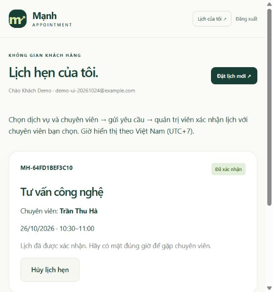

> Tài liệu ghi nhận giai đoạn v2. Hệ thống đã nâng cấp đăng nhập chung và quản trị đầy đủ các đối tượng nghiệp vụ; xem [hướng dẫn v3 hiện tại](07_HUONG_DAN_QUAN_TRI_V3.md).

# Nghiệp vụ hiện tại: đơn vị tư vấn có nhiều chuyên viên

Cập nhật 24/10/2026. Mô hình được người dùng chọn: khách hàng đặt lịch với chuyên viên của đơn vị tư vấn. Quản trị viên điều phối và xác nhận lịch. Phạm vi triển khai vẫn chỉ localhost.

## Vai trò và luồng sử dụng

| Vai trò | Chức năng đã có |
| --- | --- |
| Khách chưa đăng nhập | Xem dịch vụ/đội ngũ; đăng ký hoặc đăng nhập |
| Khách có tài khoản | Chọn dịch vụ → chuyên viên → ngày → giờ; gửi yêu cầu; xem và hủy lịch của mình trước giờ bắt đầu |
| Quản trị viên | Đăng nhập riêng, xem lịch/khách/chuyên viên, lọc ngày/trạng thái, xác nhận/hủy/hoàn tất |
| Chuyên viên | Được gắn vào lịch để xác định người tiếp nhận; hiện chưa có tài khoản đăng nhập riêng |

Khách có trang `/account` (Lịch hẹn của tôi). Header hiển thị Đăng nhập khi chưa xác thực; khi đã đăng nhập khách thì có Lịch của tôi và Đăng xuất. Liên kết đăng nhập admin nằm trong trang đăng nhập. Admin dùng tài khoản trong `.env`, khách tự đăng ký tại `/register`.

Khách gửi yêu cầu → pending → admin xác nhận với chuyên viên → confirmed → sau giờ kết thúc admin đánh dấu completed. Khách/admin có thể hủy trước giờ hẹn, giải phóng slot. Hủy không xóa lịch sử.

## Dữ liệu và kiểm soát quyền

- `customer_accounts`: email duy nhất, tên, điện thoại, hash mật khẩu scrypt có salt. Mật khẩu mới ít nhất 12 ký tự. Không lưu mật khẩu rõ.
- `customers`: ảnh chụp thông tin liên hệ cho từng lịch, bổ sung `account_id`; backend lấy tên/điện thoại/email từ tài khoản đã xác thực.
- `staff`: ba chuyên viên mẫu. `time_slots.staff_id` xác định người tiếp nhận.
- Constraint `staff_no_overlap` cấm slot chồng nhau theo từng chuyên viên; `staff_start_unique` cấm trùng thời điểm bắt đầu cùng chuyên viên. Hai chuyên viên khác nhau có thể nhận khách cùng giờ.
- Unique index lịch active theo slot và transaction khóa slot vẫn được giữ.
- API danh sách/hủy lịch cá nhân lọc quyền sở hữu trong SQL. Biết ID lịch của người khác không cấp quyền xem/hủy.
- Session khách/admin lưu PostgreSQL; đổi session ID và CSRF sau đăng nhập/đăng ký; logout hủy session.
- Rate limit nghiệp vụ theo tài khoản, khách chưa đăng nhập theo IP; Nginx giữ giới hạn tổng theo IP. Giới hạn đăng nhập/đăng ký và CSRF vẫn bật.

Migration `schema-v2.sql` bổ sung cấu trúc, giữ dữ liệu cũ và gán slot cũ cho chuyên viên đầu tiên. Lịch cũ chưa liên kết tài khoản không tự gán theo email vì email chưa được xác minh; giữ cách tra cứu token cũ.

## Kết quả kiểm tra

4 unit test đạt; 2 nhóm integration đạt trên Nginx/PostgreSQL Docker: nghiệp vụ/concurrency/admin và tài khoản/ownership/nhiều chuyên viên. Kịch bản kiểm tra xác thực, CSRF cũ, logout, mật khẩu yếu, khách không hủy được lịch người khác, hai chuyên viên cùng giờ và một slot không đặt trùng.

Tài khoản và lịch tự động dùng dữ liệu giả. Kiểm thử cần chạy trên môi trường demo; chạy nhiều lần liên tiếp có thể chạm rate limit và phải đợi cửa sổ giới hạn. Bộ test có khoảng nghỉ giữa hai kịch bản để Nginx nạp lại hạn mức.

## Giới hạn còn lại

Chưa có tài khoản riêng của chuyên viên, CRUD đầy đủ dịch vụ/nhân viên/khung giờ, chỉnh hồ sơ, xác minh email, quên mật khẩu hoặc thông báo email/SMS. Dịch vụ và lịch làm việc được seed. Các phần này chưa được coi là đã hoàn thành.

## Minh chứng giao diện và phục hồi v2

Thử trên trình duyệt bằng tài khoản giả lập: đặt lịch MH-64FD1BEF3C10 với Trần Thu Hà, admin xác nhận và khách thấy trạng thái Đã xác nhận sau tải lại.

Backup v2: `backups/appointment-20261024-044149.dump`; restore thành công vào `restore_verify_20261024044152`, schema 1 và 2, 15 lịch. Đã đối chiếu số tài khoản/chuyên viên/slot/lịch với DB nguồn; minh chứng máy `docs/evidence/v2-restore.json`. Các số liệu này là thời điểm kiểm thử, không phải dữ liệu khách thực.
