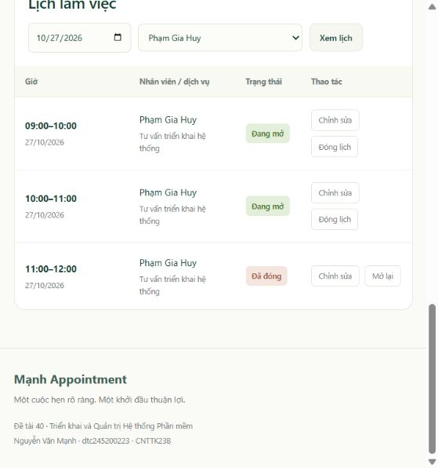

# Hướng dẫn hệ thống đặt lịch hẹn v3

Cập nhật 24/10/2026, UTC+7. Phạm vi: đơn vị tư vấn nhiều nhân viên, triển khai toàn bộ Docker Compose trên localhost.

## Đăng nhập thống nhất

Dùng duy nhất `http://localhost:8080/login` cho khách và admin. Email/mật khẩu xác định vai trò ở server; admin đến `/admin`, khách đến `/account`. `/admin/login` cũ chuyển về `/login`; không còn lựa chọn loại tài khoản trên form. Đăng xuất dùng POST `/logout` kèm CSRF.

Tài khoản admin cục bộ đã đổi theo yêu cầu người dùng; thông tin lưu trong `.env` bị gitignore. Mật khẩu không được đưa vào mã nguồn hoặc tài liệu public. Các tài khoản admin cũ bị vô hiệu hóa, phiên admin cũ được thu hồi. Nếu cần đặt lại từ cấu hình `.env`, chủ động chạy:

```powershell
docker compose run --rm --no-deps migrate node app/migrate.js --reset-admin
```

Lệnh trên thay đổi thông tin admin và thu hồi các phiên admin hiện có. Khởi động thông thường giữ nguyên mật khẩu hiện có.

## Luồng vận hành

1. Admin vào **Dịch vụ**, thêm tên, mô tả, thời lượng (15–240 phút, bội số 15), giá và trạng thái.
2. Vào **Nhân viên**, thêm họ tên/chức danh/giới thiệu và chọn dịch vụ phụ trách. Có thể chỉnh sửa hoặc ngừng nhận lịch.
3. Vào **Khung giờ**, chọn dịch vụ và nhân viên được phân công; mở một khung hoặc nhiều khung liên tiếp trong cùng ngày. Thời lượng lấy từ dịch vụ; tạo hàng loạt chạy trong một transaction.
4. Khách tự đăng ký tài khoản, đăng nhập, chọn dịch vụ → nhân viên → ngày → giờ. Chỉ thấy khung mở, tương lai, đúng phân công và chưa có khách giữ.
5. Gửi yêu cầu thành pending. Trang **Lịch hẹn của tôi** hiển thị mã lịch, chuyên viên, thời gian, phí và trạng thái.
6. Admin tìm lịch theo mã/tên khách, nhân viên, ngày hoặc trạng thái; xác nhận → confirmed. Sau giờ kết thúc có thể hoàn tất → completed.
7. Khách hủy trước giờ bắt đầu; admin có thể hủy pending/confirmed để xử lý cả yêu cầu quá giờ. Lịch hủy được giữ trong lịch sử và giải phóng slot.
8. **Khách hàng** cho phép tìm kiếm, xem lịch sử, sửa tên/điện thoại và khóa/mở tài khoản. Khóa tài khoản không tự hủy lịch đã đặt. Khách tự sửa tên/điện thoại trong hồ sơ cá nhân.

## Quy tắc bảo toàn dữ liệu

- Một nhân viên không có hai khung giờ mở chồng nhau; nhiều nhân viên có thể nhận khách cùng giờ.
- Một slot có tối đa một lịch pending/confirmed/completed; database và transaction đảm bảo chống tranh chấp.
- Ngừng dịch vụ/nhân viên hoặc bỏ phân công bị từ chối khi còn lịch pending/confirmed sắp tới.
- Không sửa thời gian/nhân viên/dịch vụ của slot đã có lịch sử đặt hẹn. Đóng slot rồi tạo mới nếu cần; slot đang có khách phải xử lý lịch trước.
- Đổi thời lượng dịch vụ yêu cầu đóng các slot tương lai của dịch vụ trước. Không âm thầm kéo dài lịch khách đã đặt.
- Tên dịch vụ, tên chuyên viên và giá được chụp tại thời điểm đặt mới. Chỉnh danh mục/hồ sơ không viết lại lịch sử liên hệ hoặc thông tin lịch cũ.
- Thao tác ngừng/đóng/khóa thay cho xóa cứng, giúp giữ lịch sử và có thể mở lại qua chỉnh sửa.
- Giờ nhập tại UI là giờ Việt Nam UTC+7; DB lưu timestamptz. Admin mở lịch tối đa 365 ngày; khách chọn trong cùng cửa sổ này.

Migration v3 giữ dữ liệu cũ. Giá các lịch trước v3 chưa có snapshot nên không suy ngược thành giá thu thực tế. Seed dữ liệu mẫu chỉ chạy ở giai đoạn khởi tạo/nâng cấp v3 lần đầu; chạy lại migration không tự tái tạo nhân viên đã đổi tên hoặc lịch đã đóng. Sau đó mở lịch qua quản trị.

## Kết quả kiểm chứng

- 4 unit test và 3 nhóm integration đạt; nhóm quản trị bao gồm CRUD, phân công, slot 60 phút, overlap, batch rollback, quyền admin, CSRF, XSS escaping, snapshot, khóa/mở tài khoản và hồ sơ.
- 15 kiểm tra stack đạt, gồm Prometheus/Grafana và 3 LogQL.
- Thử UI thật: thêm “Tư vấn triển khai hệ thống” 60 phút, phân công Phạm Gia Huy, tạo ba slot 27/10/2026; đóng slot 11:00; khách chỉ thấy 09:00 và 10:00.
- Khách Demo đặt MH-75CB5CEF4D4C lúc 09:00; admin tìm và xác nhận qua UI. Phí snapshot 300.000 đồng.
- Fresh database tạo thành công: 3 dịch vụ, 3 nhân viên, 672 slot, 9 phân công; schema version 3.
- Recreate app không reload Nginx: web smoke đạt, dữ liệu không đổi và session admin còn dùng được. Nginx sử dụng Docker DNS cập nhật upstream.
- Backup `appointment-20261024-051045.dump` phục hồi vào `restore_verify_20261024051048`: schema 1/2/3, 26 lịch tại thời điểm chụp. Checksum 8 bảng nghiệp vụ khớp DB gốc.



Minh chứng máy (gitignore): `evidence/stack-verification.json`, `evidence/v3-recreate.json`, `evidence/v3-restore.json`, `evidence/fresh-schema-v3.json`.

## Phạm vi còn lại

Nhân viên là đối tượng được admin quản lý/phân công, chưa có tài khoản đăng nhập riêng. Chưa có email/SMS, xác minh email, quên mật khẩu, thanh toán, đồng bộ lịch ngoài, kiểm thử tải dài hạn hoặc quét toàn bộ image. Danh sách quản trị có giới hạn số dòng và bộ lọc; chưa có phân trang đầy đủ. Báo cáo Word cuối chưa được viết. Không tuyên bố không còn mọi lỗi hoặc đã đủ điều kiện vận hành Internet.
