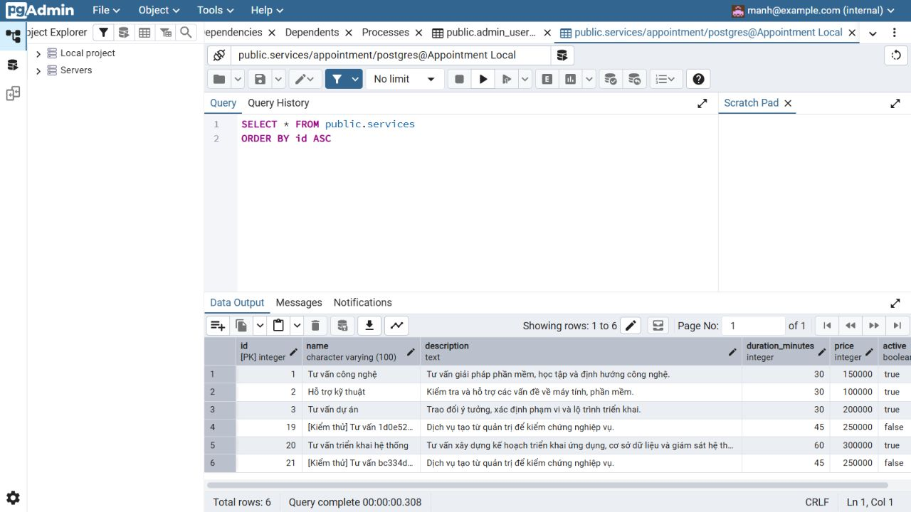
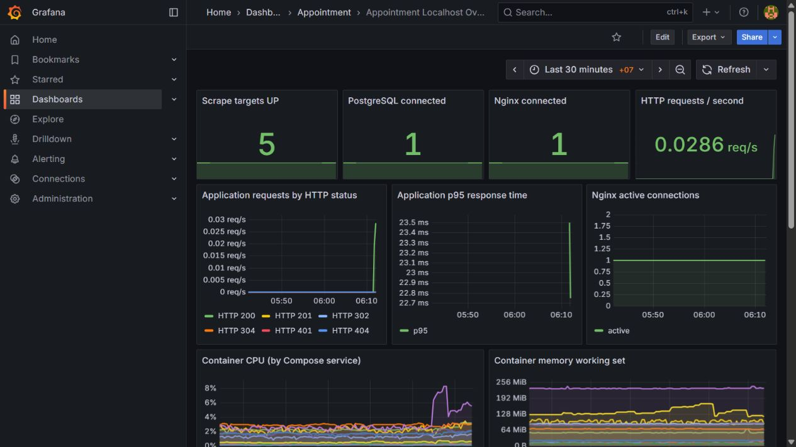
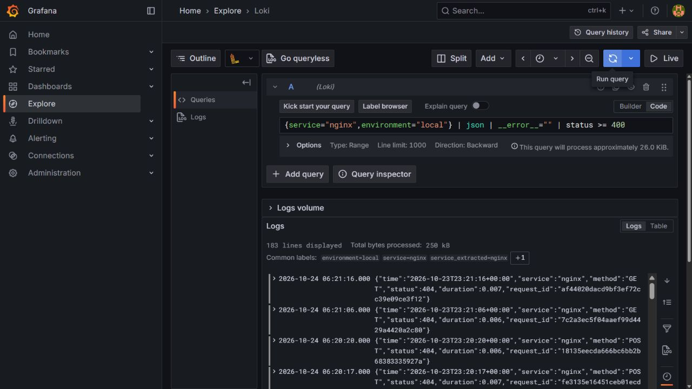

# Đối chiếu đề 40 và báo cáo triển khai hệ thống

Ngày kiểm tra: 24/10/2026, múi giờ Asia/Bangkok (UTC+7). Phạm vi là bản Docker Compose localhost theo yêu cầu người dùng. Không đánh giá như một bản vận hành Internet.

## Kết luận

Ứng dụng và các nhóm hạ tầng chính đã đáp ứng phần triển khai của đề 40. Chưa thể kết luận bài nộp hoàn tất: chưa có báo cáo Word cá nhân tối thiểu 10 trang, hướng dẫn clone/fresh clone còn thiếu và một số nội dung báo cáo mẫu chưa khớp hệ thống thật. Không dùng số kiểm tra kỹ thuật đạt để suy ra điểm số hoặc toàn bộ tiêu chí đã hoàn thành.

Nguồn đối chiếu:

- S01: `docx/Đề tài Thực hành - Triển khai và Quản trị Hệ thống Phần mềm (Đề 40).docx`.
- S02: `docx/Bao_Cao_Trien_Khai_He_Thong.docx`, SHA256 `02c9189f6e9a969c92e76b214a255d133b5261f8e1f9b9198b68a3f6b6149a13`. Đọc lại trực tiếp OOXML: 48 đoạn thân bài, 0 bảng, 0 media nhúng, còn placeholder họ tên/MSSV/lớp. Không suy số trang từ metadata chưa render.
- Mã nguồn GitHub, Compose, cấu hình Nginx/Prometheus/Grafana/Promtail và probe runtime; kết quả máy ở `docs/evidence/requirements-audit.json`.

Các nhãn Pxx của nguồn tham chiếu đoạn trong bản trích xuất `docs/sources`, không phải số trang Word.

## Đối chiếu yêu cầu bắt buộc của đề 40

| Yêu cầu | Kết quả hiện tại | Kết luận |
| --- | --- | --- |
| Website dịch vụ, khung giờ, khách hàng, xác nhận (S01 P44) | Frontend EJS/JS, backend Express, PostgreSQL; đăng nhập chung; CRUD dịch vụ/nhân viên/phân công/slot; khách đặt và xem/hủy; admin xác nhận/hoàn tất | Đạt trong phạm vi chức năng đã kiểm thử |
| PostgreSQL và pgAdmin (P45, P23) | DB schema 1/2/3; app kết nối; pgAdmin đăng nhập và hiển thị bảng services 6 dòng, Query complete | Đạt runtime và có ảnh |
| Tất cả dịch vụ Compose (P14, P38) | 13 service sau sửa xoay log: 11 chạy liên tục, migrate/log-init kết thúc exit 0 | Đạt tại thời điểm kiểm tra |
| GitHub, source/config, README, ít nhất 3 commit có ý nghĩa (P4, P20) | GitHub main khớp local; lịch sử có các commit Nginx, metrics, Loki, chức năng; README có setup và chạy | Đạt source/commit; hướng dẫn clone và fresh clone còn thiếu |
| Đặt tên theo MSSV (P4) | Repo `dtc245200223_dat_lich_hen` có MSSV; username GitHub là `vzmanhdev` | Tên repo phù hợp; nếu GV bắt buộc username tài khoản trùng MSSV thì chưa đáp ứng cách hiểu đó |
| Nginx reverse proxy, HTTPS tự ký **hoặc** headers (P6, P26) | Web qua Nginx 8080; SAMEORIGIN, nosniff, Referrer/Permissions và CSP; metrics/health nội bộ bị chặn | Đạt phương án headers; chưa có HTTPS |
| Prometheus/Grafana giám sát container/web/DB (P7, P29) | 5 target UP; 12 panel Prometheus đều có mẫu hữu hạn trong 30 phút; 1 panel logs; CPU/RAM theo 11 service, Nginx và PostgreSQL có dữ liệu | Đạt các nhóm giám sát đề yêu cầu |
| Loki/Promtail và 2–3 LogQL (P8, P32) | Có nguồn app, Nginx, PostgreSQL; 3 query trong LOGQL.md trả kết quả; API Loki và giao diện Explore được kiểm tra | Đạt; cần đưa minh chứng vào báo cáo cuối |
| Ít nhất 3–4 hardening (P9, P35) | App UID node, read-only, cap_drop ALL, no-new-privileges; mạng DB internal, không mở 5432; role app không owner/superuser; secrets ngoài Git; headers/CSRF/session/rate limit | Đạt nhiều hơn 4 biện pháp; ghi rõ ngoại lệ cAdvisor privileged |
| Báo cáo tối thiểu 10 trang, bìa đúng thông tin và ảnh kết quả (P10–12) | Có tài liệu Markdown và ảnh kiểm chứng; chưa có báo cáo Word cá nhân cuối | Chưa đạt |
| Demo đủ website, DB tool, dashboard, LogQL, hardening (P14, P38) | Website đặt/xác nhận đã thử; pgAdmin và Grafana đã xem; logs qua query và probe; chưa diễn tập demo đầy đủ một lượt có kịch bản/ghi hình | Một phần; cần hoàn thiện hồ sơ/demo |

Đã có kết quả trước đó: 4 unit test, 3 nhóm integration PostgreSQL thật; fresh schema v3; app recreate giữ dữ liệu; backup/restore 8 bảng có checksum khớp. Không chạy lại toàn bộ integration chỉ để tăng số lần kiểm thử khi source nghiệp vụ không đổi. Đợt kiểm tra này tập trung runtime và đối chiếu tài liệu.

## Những điểm khác báo cáo mẫu

| Nội dung S02 | Hệ thống thực tế | Cách ghi báo cáo đúng |
| --- | --- | --- |
| P13 gọi toàn bộ là microservices | Web là một backend Express có các module; hạ tầng triển khai nhiều container | Gọi kiến trúc ứng dụng và hạ tầng đa dịch vụ Docker; không tự nhận đã tách nghiệp vụ thành microservices |
| P14 Internet, cổng 80/443 | Chỉ bind 127.0.0.1:8080, 5050, 3001, 9090 theo phạm vi người dùng | Vẽ sơ đồ localhost; không mô tả đã public Internet |
| P26 HTTPS tự ký cùng headers | Chỉ HTTP và headers | Không ghi đã có TLS. Đề S01 cho phép chọn headers nên đây không phải thiếu bắt buộc của đề |
| P29 X-XSS-Protection 1; mode=block | Header thực là 0, có CSP | Không bật lại chỉ để giống mẫu. Header này đã deprecated; ưu tiên CSP theo MDN |
| P32 CPU, memory, Network I/O | CPU/RAM có panel; metric network có sẵn nhưng dashboard chưa có panel Network I/O | Ghi rõ phần thiếu nếu muốn bám đầy đủ mẫu; có thể bổ sung panel sau |
| P34 log mọi Docker container | Promtail đọc file log app, Nginx access và PostgreSQL; không thu stdout/stderr của tất cả service | Mô tả đúng 3 nguồn đang thu. Đề chung chỉ yêu cầu hệ log tập trung và query, không ghi bắt buộc toàn bộ stdout |
| P36–38 query dùng job nginx/webapp và log text | Hệ thống dùng nhãn service/environment, Nginx JSON, Pino level dạng số | Dùng query thật trong LOGQL.md; không sao chép query mẫu chưa kiểm chứng, trong đó query HTTP mẫu có lỗi cú pháp |
| P42 non-root ngăn tuyệt đối leo thang đặc quyền | Non-root là một lớp giảm rủi ro; cAdvisor vẫn privileged để đo host/container | Nêu giới hạn, không kết luận bảo đảm tuyệt đối |
| P45 iptables/UFW | Chưa có minh chứng cấu hình host firewall riêng; host đang Windows + WSL/Docker Desktop | Không ghi đã cấu hình UFW trên host Linux. Network isolation và port loopback không đồng nghĩa đã nghiệm thu firewall |
| P6 thông tin sinh viên dạng placeholder; P47 kết luận hoàn thiện | File nguồn chưa có thông tin cá nhân hoàn chỉnh và không có ảnh nhúng | Đây là mẫu, chưa phải báo cáo kết quả cá nhân. Bìa báo cáo cuối theo S12 mà người dùng đã chỉ định |

Nguồn kỹ thuật kiểm chứng nhận xét X-XSS-Protection: https://developer.mozilla.org/en-US/docs/Web/HTTP/Reference/Headers/X-XSS-Protection .

## Lỗi vận hành tìm thấy và đã sửa trong đợt kiểm tra

Lần kiểm tra sâu đầu phát hiện `nginx-log-rotate` exited 137, OOMKilled=false. Docker báo không tham gia được PID namespace của Nginx sau khi Nginx khởi động lại. Bộ kiểm tra cũ không có điều kiện kiểm tra mọi sidecar nên chưa phát hiện trường hợp này.

Đã đưa tiến trình xoay log vào cùng container Nginx, bỏ sidecar dùng PID namespace chéo. Giữ ngưỡng mặc định 10 MiB và ba thế hệ access.log, access.log.1, access.log.2. Thử xoay thực bằng ngưỡng nhỏ, kiểm tra file cũ còn, file mới tiếp tục ghi và restart Nginx: web HTTP 200 và tiến trình xoay log phục hồi cùng nhau.

`verify-stack.js` đã tăng từ 15 lên 16 mục, kiểm tra service dự kiến có mặt, mọi service chạy dài hạn đang running và các one-shot exit 0. Sau sửa: 16/16 đạt. `audit-requirements.js` có thêm 9 probe sâu; 9/9 đạt trong phạm vi những probe đó, không thay thế kiểm tra toàn bộ rubric.

Minh chứng: `evidence/requirements-audit-before.json`, `evidence/log-rotation-verification.json`, `evidence/requirements-audit.json`, `evidence/stack-verification.json`. JSON vận hành được gitignore; bản sửa source đã push commit `034f0e3`.

### Thu trùng và sai thời gian sự kiện khi xoay file

Đối chiếu cùng một request_id trong Loki cho thấy cùng event_time có hai bản: từ access.log và access.log.1. Promtail trước đó quét cả file đã xoay và dùng thời gian thu thay cho trường time trong JSON. Điều này có thể làm số đếm LogQL tăng và đưa log cũ vào khoảng thời gian mới.

Đã giới hạn app/Nginx vào file hiện hành app.log/access.log và thêm pipeline parse JSON time theo RFC3339Nano. Kiểm thử request thật trước/sau xoay file: mỗi request mới có đúng một bản, timestamp khớp; kiểm tra riêng log app cũng đạt. PostgreSQL hiện vẫn theo thời gian thu vì log plaintext. Không xóa hoặc viết lại các bản log cũ đã có trong Loki; dữ liệu lịch sử có thể còn bản trùng đến khi hết retention. Không dùng số đếm lịch sử chưa làm sạch để kết luận SLA.

Bản sửa đã push `78b2991`. Kiểm thử tái lập: `node scripts/test-log-rotation.js` (có restart Nginx) và `node scripts/test-log-ingestion.js` (có tạo request thử và xoay file log). Minh chứng `evidence/log-ingestion-verification.json`.

## Minh chứng mới

## Việc còn lại theo ưu tiên

1. **Bắt buộc trước khi nộp:** viết báo cáo Word cá nhân ít nhất 10 trang, đúng bìa/thông tin; có sơ đồ, giải thích 6 bước, ảnh thật và kết quả kiểm thử. Không dùng mẫu hiện tại làm báo cáo hoàn chỉnh.
2. **Hướng dẫn tái lập:** thêm lệnh git clone/cd cụ thể vào README; diễn tập từ checkout sạch và chạy demo đủ các thành phần. Fresh database đã thử, chưa tương đương fresh clone toàn stack.
3. **Nếu cần khớp toàn bộ nội dung mẫu:** bổ sung dashboard Network I/O; thống nhất việc có cần TLS tự ký, log mọi container và minh chứng firewall hay sửa mô tả mẫu cho đúng phạm vi localhost.
4. **Không sao chép kết luận quá mức:** dùng LogQL/labels thật, ghi ngoại lệ hardening và sự khác nhau giữa web monolith và kiến trúc microservices.

Chưa chấm điểm dự kiến hoặc kết luận “đủ 10/10”; người đánh giá quyết định theo demo và báo cáo nộp thực tế.
