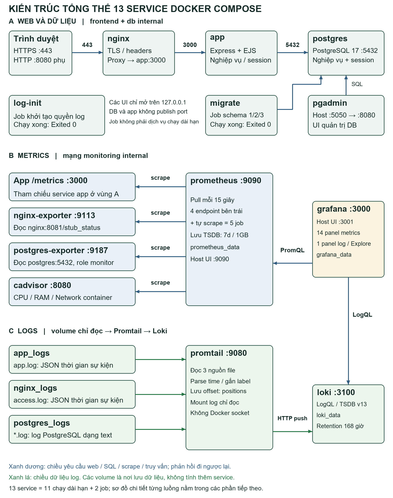

# Kiến trúc đầy đủ và cách đọc hệ thống quan sát

Bản tổng thể gồm toàn bộ 13 service trong `compose.yaml`: 11 service chạy dài hạn và hai job `log-init`, `migrate` kết thúc với exit 0. Các volume và endpoint app `/metrics` không được tính thêm thành service.

## Ba luồng trên cùng sơ đồ

1. **Web và dữ liệu:** trình duyệt → HTTPS Nginx → Express/EJS → PostgreSQL. pgAdmin và migrate cũng kết nối PostgreSQL; log-init cấp quyền thư mục log trước khi service chạy.
2. **Metrics:** Prometheus chủ động scrape app, nginx-exporter, postgres-exporter, cAdvisor và chính nó. Grafana gửi PromQL đến Prometheus để lấy số liệu dashboard.
3. **Logs:** app/Nginx/PostgreSQL ghi file vào ba volume; Promtail đọc file, gắn nhãn/thời gian rồi push tới Loki. Grafana gửi LogQL đến Loki để hiển thị log.

Mũi tên xanh dương chỉ chiều yêu cầu; phản hồi đi ngược lại. Mũi tên xanh lá chỉ chiều dữ liệu log. Sơ đồ riêng [web](evidence/diagrams/01-web-data-flow.png), [metrics](evidence/diagrams/02-metrics-pull-flow.png), [logs](evidence/diagrams/03-log-collection-flow.png) giúp đọc phóng lớn từng luồng.

## Chức năng và cách truy cập từng service

| Service | Vai trò | Đích nội bộ hoặc truy cập host |
| --- | --- | --- |
| log-init | Cấp UID/quyền cho ba thư mục log; job chạy một lần | Không có mạng; Exited 0 là bình thường |
| postgres | Lưu lịch hẹn, dịch vụ, khách, tài khoản, session | postgres:5432, không publish host |
| migrate | Áp schema 1/2/3 và khởi tạo có điều kiện | Kết nối postgres:5432; Exited 0 |
| app | Backend Express, frontend EJS, API, phân quyền/transaction | app:3000; /metrics là endpoint cùng service |
| nginx | TLS, proxy web, headers, rate limit | https://localhost:8443; HTTP 8080 phụ |
| pgadmin | Giao diện truy vấn/quản trị DB | http://localhost:5050 → pgadmin:8080 |
| nginx-exporter | Chuyển stub_status Nginx thành metrics | :9113/metrics; nguồn nginx:8081/stub_status |
| postgres-exporter | Đọc thống kê DB bằng role monitor | :9187/metrics; nguồn postgres:5432 |
| cadvisor | CPU/RAM/network của container | cadvisor:8080/metrics; ngoại lệ privileged |
| prometheus | Thu và lưu chuỗi thời gian mỗi 15s | http://localhost:9090; nội bộ prometheus:9090 |
| grafana | Dashboard metrics, Explore và panel log | http://localhost:3001 → grafana:3000 |
| promtail | Đọc ba nguồn file, parse time, ghi offset, push log | :9080 nội bộ; client tới loki:3100 |
| loki | Lưu/chỉ mục log và xử lý LogQL | loki:3100, không publish host |

Cổng host đều bind 127.0.0.1. HTTPS hiện bảo vệ website; các UI Grafana/Prometheus/pgAdmin vẫn dùng HTTP loopback riêng. Tài khoản công cụ nằm trong `.env` cục bộ; không đưa mật khẩu vào báo cáo/Git.

## Nguồn cấu hình và dữ liệu

| Thành phần | File cấu hình | Dữ liệu bền vững và thông số |
| --- | --- | --- |
| Prometheus | `infra/prometheus/prometheus.yml` | prometheus_data; 5 job; scrape 15s; TSDB 7d/1GB |
| Grafana datasource | `infra/grafana/provisioning/datasources/datasources.yaml` | Prometheus UID prometheus, Loki UID loki; access proxy |
| Grafana dashboard | `infra/grafana/dashboards/appointment.json` | 15 panel: 14 Prometheus, 1 Loki; refresh 15s |
| Grafana provider | `infra/grafana/provisioning/dashboards/dashboards.yaml` | Folder Appointment, đọc file mỗi 15s; grafana_data giữ DB Grafana |
| Loki | `infra/loki/config.yaml` | loki_data; TSDB v13/filesystem, một node; retention/lookback 168h |
| Promtail | `infra/promtail/config.yaml` | app_logs/nginx_logs/postgres_logs chỉ đọc; promtail_positions ghi offset |
| Nginx | `infra/nginx/default.conf` | nginx_logs; TLS key/cert cục bộ không vào Git |
| Toàn stack | `compose.yaml` | postgres_data, pgadmin_data và các volume quan sát/log nêu trên |

Promtail chỉ thu ba nguồn file cốt lõi, chưa thu stdout/stderr của toàn bộ container. App/Nginx dùng JSON event time; log PostgreSQL text hiện dùng thời điểm thu. Prometheus chưa cấu hình Alertmanager/rule cảnh báo tự động. Loki một node và các volume cùng máy chưa tạo khả năng chịu mất máy. Phạm vi các giới hạn được ghi trong báo cáo.

## Đọc và kiểm tra

- Prometheus: mở `/targets`, đối chiếu 5 job; `up=1` chỉ nói scrape thành công. `pg_up`/`nginx_up` mới phản ánh exporter đọc được dịch vụ nguồn.
- Grafana: folder Appointment → Appointment Localhost Overview. Đối chiếu range 30 phút và múi giờ; rate cần ít nhất hai scrape.
- Explore: chọn Loki, dùng `{service="app",environment="local"}` hoặc các truy vấn trong [LOGQL.md](LOGQL.md).
- No data: kiểm tra target, datasource UID, thời gian, batch ingestion và mount file; không thay giá trị thiếu bằng 0.
- Bộ kiểm tra: `node scripts/verify-stack.js` và `node scripts/audit-requirements.js`; đọc phạm vi từng mục, không suy ra nghiệp vụ chỉ từ target UP.

Báo cáo Word hiện hành trình bày thêm toàn bộ 15 biểu thức panel, vai trò/config/giới hạn từng thành phần, bảng kết nối và chín volume. Xem [thư mục báo cáo](../reports/README.md).
