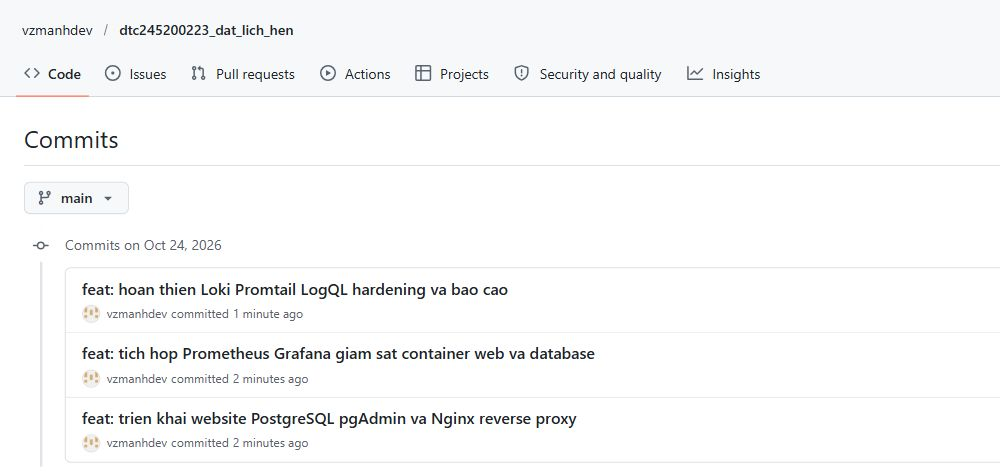

# Ba mốc Git và cách trình bày đề 40

Nhánh `main` đã được tổ chức lại thành đúng ba commit theo lựa chọn của sinh viên. Đây là lịch sử gộp để trình bày, không phải khẳng định phần mềm chỉ được viết trong ba lần thao tác. Source cuối giữ nguyên chức năng; cập nhật mới là báo cáo, minh chứng, cách trình bày lịch sử và mặc định cổng HTTPS host 443.

| Mốc | SHA hoặc cách tra | Hiểu đơn giản | Phần cần chỉ ra khi demo |
| --- | --- | --- | --- |
| 1 — Web và Nginx | `7e2bec8` | Đưa website lên, lưu dữ liệu và đi qua cổng proxy | Browser → Nginx → app → PostgreSQL; pgAdmin xem DB |
| 2 — Monitoring | `5a8ee51` | Xem hệ thống đang hoạt động ra sao | Prometheus scrape năm target, Grafana xem web/DB/CPU/RAM/network |
| 3 — Logging và hardening | `git log -1 --oneline` | Xem sự kiện đã xảy ra và giảm quyền truy cập | Promtail → Loki ← Grafana; ba LogQL; UID/DB role/network/headers |



Mốc cuối chứa cả các sửa lỗi, hoàn thiện chức năng, HTTPS, kiểm thử và báo cáo. Khi cần bổ sung hồ sơ sau khi gộp, cập nhật mốc cuối để giữ đúng ba commit. Không tự chạy rebase/reset hoặc force push lần nữa nếu chưa hiểu cơ chế và chưa sao lưu.

## Các câu cần hiểu

- **Frontend** là trang EJS/CSS/JS hiển thị cho khách và admin. **Backend** là Express xác thực, kiểm tra quyền, xử lý API/transaction. **PostgreSQL** giữ dữ liệu thật. pgAdmin chỉ là công cụ quản trị DB.
- **Nginx** nhận HTTPS tại `https://localhost` (host 443 → container 8443), giải mã TLS rồi chuyển HTTP tới app:3000. Chứng chỉ tự ký không tự thành CA tin cậy chỉ vì bỏ port URL.
- **Prometheus** thu và lưu số liệu. **Exporter** chuyển số liệu Nginx/DB về dạng Prometheus. **cAdvisor** quan sát tài nguyên container. **Grafana** truy vấn để vẽ dashboard; năm target UP chưa thay kiểm thử đặt lịch.
- **Promtail** đọc file log app/Nginx/PostgreSQL và đẩy sang **Loki**. **Grafana Explore** gửi **LogQL** tới Loki; không cần cổng public cho Loki/Promtail.
- **Hardening** phải chỉ được bằng cấu hình và kết quả: app UID 1000, read-only/cap_drop, network internal, DB role ít quyền, CSRF/session và headers. cAdvisor privileged là ngoại lệ công cụ giám sát, không phải quyền của app.

## Lệnh đối chiếu

```powershell
git rev-list --count main
git log --reverse --oneline main
git show --stat 7e2bec8
git show --stat 5a8ee51
git show --stat main
docker compose ps -a
node scripts/verify-stack.js
node scripts/audit-requirements.js
node scripts/verify-tls.js
```

Kỳ vọng `git rev-list --count main` bằng 3. Các tag release cũ có thể vẫn trỏ vào lịch sử trước khi gộp; số ba ở đây áp dụng cho chuỗi commit của `main`. Bundle sao lưu cùng bản chưa commit trước thao tác được giữ cục bộ ở `backups/git-before-three-commits-20261024/`, không đưa lên GitHub. Các SHA được ghi trong biên bản kiểm thử cũ là snapshot lịch sử, không phải SHA hiện hành sau gộp.

## Đối chiếu bảy tiêu chí

Báo cáo hiện hành giữ bốn chương theo mẫu triển khai và vẫn bao phủ bảy tiêu chí: GitHub (1,5) ở 1.2; ứng dụng/DB (1,5) ở 2.1; Nginx (1,5) ở 2.2; monitoring (1,5) ở 3.1; Loki/LogQL (1,5) ở 3.2; hardening (1,5) ở 4.1; tổng thể/demo (1,0) ở 4.2 và kết luận. Mỗi chương có yêu cầu, cách triển khai, chức năng, kết quả và minh chứng. Điểm do giảng viên chấm, không tự xác nhận 10/10.

Tài khoản GitHub vẫn là `vzmanhdev`, tên repository có MSSV. Điều kiện tài khoản đặt tên theo MSSV chưa khớp nguyên văn; cần đối chiếu giảng viên. Video chỉ thực hiện khi lớp yêu cầu; hiện hồ sơ chưa có video.
